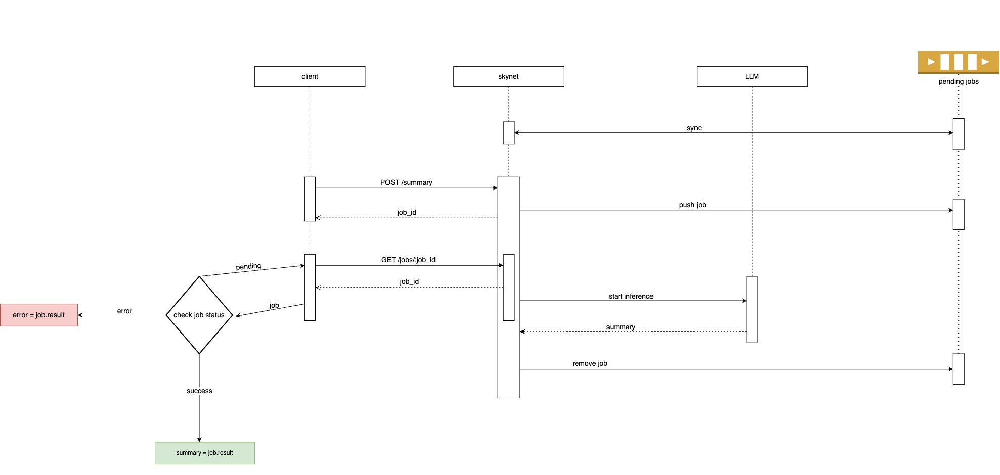

# Skynet Summaries Module

Extracts summaries and action items from a given text. The service can be deployed to use either vllm or Ollama. It is split into two sub-modules: `summaries:dispatcher` and `summaries:executor`.

`summaries:dispatcher` will do CRUD for jobs with a Redis installation, while `summaries:executor` performs the actual inference. They can both be enabled at the same time or deployed separately.

> All requests to this service will require a standard HTTP Authorization header with a Bearer JWT. Check the [**Authorization page**](auth.md) for detailed information on how to generate JWTs or disable authorization.

## Requirements

- Redis
- Poetry

## Flowchart



## Configuration

All of the configuration is done via env vars. Check the [Skynet Environment Variables](env_vars.md) page for a list of values.

## First run

```bash
# disable authorization
export BYPASS_AUTHORIZATION=1

# start Redis
docker run -d --rm -p 6379:6379 redis

# If using vLLM (running on NVIDIA GPU)
export LLAMA_PATH="$HOME/models/Llama-3.1-8B-Instruct"
poetry install --with vllm

# If using Ollama
export LLAMA_PATH="llama.3.1"
poetry install

# Optional: local language detection (otherwise the LLM detects the payload's language)
mkdir -p models/language_id
curl -L -o models/language_id/glotlid_v4_small.ftz \
  https://huggingface.co/cis-lmu/glotlid/resolve/e9592e0a9bc3b6f2a946de94faaa188d1dd6f522/model_v4_small.ftz

./run.sh
```

Visit http://127.0.0.1:8000

## Build Image

```bash
docker buildx build --push --progress plain --platform linux/amd64 -t your-registry/skynet:your-tag .
```

When running the resulting image, make sure to mount a model under `/models` on the container fs.

### Code samples

JavaScript: https://github.com/jitsi/skynet/blob/master/docs/sample.js
